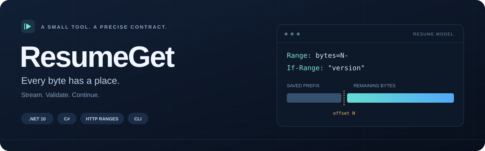
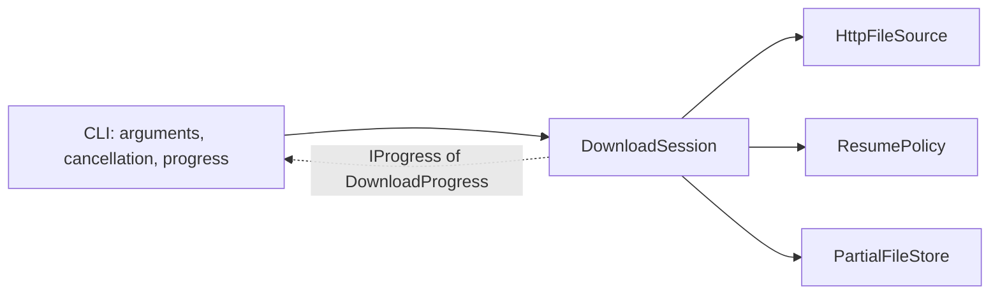

<p align="center">
  
</p>

<p align="center">
  <strong>Interrupted download. Saved progress. A checked path forward.</strong><br />
  C# · .NET 10 · HTTP byte ranges · Streaming I/O · xUnit
</p>

<p align="center">
  <a href="https://github.com/abdrhmanZ/ResumeGet/actions/workflows/ci.yml"></a>
</p>

<p align="center">
  <a href="#quick-start">Quick start</a> ·
  <a href="#try-an-interruption">Demo</a> ·
  <a href="#architecture">Architecture</a>
</p>

ResumeGet is a small command-line downloader with one central question: **when can a new HTTP response safely continue an existing partial file?**

Run the same command after an interruption. The engine checks the file version, byte range, and saved state before appending. If the response cannot be accepted, it preserves the existing prefix and explains the failure.

> **Verified on GitHub Actions:** Release build, **23 passing tests**, and the CLI interruption/resume demo with a matching SHA-256. [View the successful run](https://github.com/abdrhmanZ/ResumeGet/actions/runs/42012076126) · [Verification record](VERIFICATION.md).

## Features

| Engineering concern | Implementation |
| --- | --- |
| HTTP correctness | Conditional range requests with a strong ETag, plus response validation before writing |
| File ownership | Exclusive session lock, paired metadata and partial file, no overwrite of an existing destination |
| Bounded transfer memory | A 64 KiB copy buffer with streamed HTTP responses |
| Interruptible work | Ctrl+C cancellation and 30-second header/body-read timeouts |
| Separation of concerns | CLI presentation separated from transfer orchestration, HTTP policy, and storage |
| Failure testing | Real local HTTP responses and temporary files, including deliberately interrupted transfers |

## Quick start

You need a **.NET 10 SDK**. Run these commands from the repository root:

```powershell
dotnet restore ResumeGet.slnx
dotnet build ResumeGet.slnx --configuration Release --no-restore

$url = Read-Host 'Direct HTTP(S) download URL'
dotnet run --project src/ResumeGet.Cli --configuration Release --no-build -- $url --output ./downloads/file.bin
```

Press **Ctrl+C** to stop, then run the same download command to attempt resume. Choose an unused output path for a fresh download. Resume needs a **strong ETag**, a **known total size**, and server support for conditional byte ranges.

The CLI accepts `resumeget <url> --output <path>`, plus standalone `--help` and `--version`. URLs must be HTTP(S), without embedded credentials or a fragment.

| Exit code | Meaning |
| --- | --- |
| `0` | Completed, or help/version displayed |
| `1` | Download, storage, or resume validation failed |
| `2` | Invalid or missing arguments |
| `130` | Cancelled with Ctrl+C |

## Try an interruption

The included demo uses **PowerShell 7** and a loopback HTTP server. No external download URL is needed.

```powershell
pwsh -File scripts/demo.ps1
```

The script creates a 512 KiB sample, sends only its first 128 KiB, and closes the first response early. It then runs the same CLI command again, checks the `Range` and `If-Range` headers, and compares the completed file with the original using SHA-256.

The demo builds the CLI by default. After publishing as shown below, use `-CliPath ./publish/resumeget.dll` to try that build instead. `-OutputDirectory` selects a **new** directory; otherwise the script creates a temporary one and prints its path. The files are kept for inspection and the server job is stopped on exit.

## The resume contract

Suppose 1,000 bytes of a 5,000-byte file are already saved with ETag `"v1"`. The next request contains:

```http
Range: bytes=1000-
If-Range: "v1"
Accept-Encoding: identity
```

A response continuing to the end would describe `Content-Range: bytes 1000-4999/5000`. Before appending, the engine requires:

- HTTP `206`, identity encoding, and the same final URL.
- A range starting at the current partial-file length, with the saved total and a valid end.
- A `Content-Length` consistent with the range, when that header is present.
- The saved strong ETag, if the response includes an ETag. Conditional `206` responses may omit it.

A valid shorter range is retained, but does not finalize the file. Rerunning can request the remaining bytes.

| Server or local-state problem | Result |
| --- | --- |
| `200` returned during resume | Refuse to append a full response to the old prefix |
| `416`, changed ETag/final URL, or inconsistent range | Reject the response and keep the saved prefix |
| Missing or weak ETag, or unknown total | An uninterrupted download can finish; a nonempty partial cannot resume |
| Missing companion file or malformed metadata | Preserve the state instead of guessing how to recover it |
| Existing destination or lock path | Refuse to use that output; preserve the existing file |
| Interrupted connection, cancellation, or timeout | Stop the attempt and retain any saved transfer state |

To restart after a rejected resume, choose a new output name or move the `.part` and `.resume.json` files together while no session is running.

## Architecture



| Location | Responsibility |
| --- | --- |
| [`ResumeGet.Cli`](src/ResumeGet.Cli) | Parse commands, compose the engine, display progress, map failures to exit codes |
| [`DownloadSession`](src/ResumeGet.Engine/DownloadSession.cs) | Order the transfer, cancellation, and finalization steps |
| [`HttpFileSource`](src/ResumeGet.Engine/HttpFileSource.cs) | Build HTTP requests and stream responses |
| [`ResumePolicy`](src/ResumeGet.Engine/ResumePolicy.cs) | Decide whether a response is acceptable |
| [`PartialFileStore`](src/ResumeGet.Engine/PartialFileStore.cs) | Own the partial file, metadata, and exclusive lock |
| [`ResumeGet.Tests`](tests/ResumeGet.Tests) | Exercise the engine through real HTTP and filesystem boundaries |

The engine has no dependency on terminal presentation. `HttpClient` is supplied by the caller; the production projects use no external NuGet packages.

### Design decisions

For `archive.zip`, the tool owns `archive.zip.part`, `archive.zip.resume.json`, and a temporary `archive.zip.resume.lock`.

- **Disk length is the resume offset.** A separate persisted counter could disagree with the bytes actually saved.
- **Metadata precedes body writes.** It records the original/final URL, validator, total size, and format version through a temporary file.
- **The final name signals completion.** The partial file is flushed, closed, and moved without overwriting an existing destination. A complete saved partial can be finalized on the next run without another HTTP request.
- **One invocation is one attempt.** Automatic retry policy, parallel segments, and queues are outside this project's scope.

## Tests and publishing

```powershell
dotnet test ResumeGet.slnx --configuration Release
```

The suite contains **23 cases**, including repeated interruption, cancellation, concurrent writers, unsafe responses, malformed state, and existing-file preservation. A small TCP server controls the responses; assertions compare actual file bytes. The [GitHub Actions workflow](.github/workflows/ci.yml) restores, builds, runs the tests, and verifies the CLI demo on Windows. Current execution evidence is recorded in [VERIFICATION.md](VERIFICATION.md).

To publish a framework-dependent CLI:

```powershell
dotnet publish src/ResumeGet.Cli/ResumeGet.Cli.csproj --configuration Release --self-contained false -p:UseAppHost=false --output ./publish
dotnet ./publish/resumeget.dll --help
```

Keep the published files together. Running the published DLL requires a **.NET 10 runtime**. `global.json` selects stable .NET 10 SDKs from 10.0.100 onward within that major/minor version.

## Deliberate limits

- One file and one connection per invocation. No GUI, login flow, or custom authentication headers.
- Resume trusts the server's validator and assumes temporary files have not been edited externally. Normal downloads do not verify a remote checksum; SHA-256 comparison belongs to the demo's known sample.
- Flush and rename operations are not a guarantee of recovery after power loss. An unknown-length body can finish at end of stream, but its interrupted partial cannot resume.
- Metadata contains original and final URLs, including query strings. Keep it private when a URL contains an access token.
