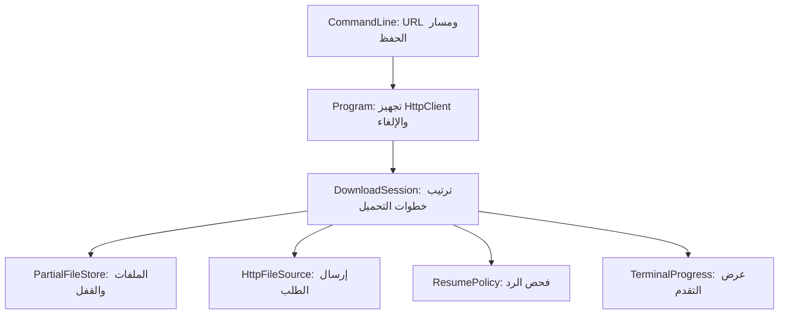

# ResumeGet — افهم المشروع واعرف تشرحه

ResumeGet أداة سطر أوامر بتحمّل ملف. لو التحميل اتقطع، بتحتفظ بالجزء اللي وصل، ولما تشغّل نفس الأمر بتحاول تكمل من مكانه. الشغل الهندسي هنا هو اتخاذ قرار صح: **هل البايتات اللي جاية ينفع تتضاف على البايتات القديمة؟**

لو السيرفر غيّر الملف، أو تجاهل طلب الاستكمال، الإضافة العمياني ممكن تطلع ملف حجمه كبير وشكله مكتمل لكنه بايظ. المشروع بيخلي قواعد القبول واضحة قبل الكتابة.

**حالة النسخة بتاريخ 2026-11-05:** البناء نجح، لكن تشغيل الاختبارات اتمنع بسياسة Windows Application Control عند تحميل مكتبة المحرك غير الموقّعة. الديمو ما اتشغّلش، والـCI متجهّز لكنه ما اتنفّذش. راجع [سجل التحقق](../VERIFICATION.md) قبل ما تقول إن المشروع اختُبر عمليًا. الأوامر هنا للتشغيل في بيئة معتمدة تسمح بالمشروع.

## ليه المشروع مناسب لحجمه؟

المشكلة صغيرة كمنتج، وفيها قرارات تقدر تناقشها: HTTP، التعامل مع الملفات، فصل المسؤوليات، إلغاء عملية شغالة، منع الكتابة المتزامنة، واختبارات أخطاء الشبكة. مفيش قاعدة بيانات أو سيرفر منشور أو حسابات مستخدمين محتاجين إدارة.

قوة عرضك هتيجي من فهمك للقرارات وحدودها. اقرأ الكود، جرّب الحالات لما التشغيل يتاح، واكتب ملاحظاتك على اللي فهمته أو غيّرته. ما تنسبش لنفسك تجربة أو نتيجة اختبار ما حصلتش.

## الأركتكتشر في 3 مشاريع

| المشروع | مسؤوليته |
| --- | --- |
| `ResumeGet.Cli` | يفهم الأمر، يعرض التقدم، يحوّل Ctrl+C لإلغاء، ويرجع exit code |
| `ResumeGet.Engine` | ينفّذ التحميل ويقرر إمتى يقبل الاستكمال ويحفظ الملفات |
| `ResumeGet.Tests` | يختبر المحرك بملفات حقيقية وسيرفر HTTP محلي متحكَّم في ردوده |

الـCLI يعتمد على الـEngine. المحرك ما يعرفش `Console` ولا شكل شريط التقدم؛ بيبلغ عن تقدم التحميل من خلال `IProgress<DownloadProgress>`. ده يخليك تقدر تغيّر الواجهة بعدين من غير نقل قواعد HTTP داخلها.

دي حدود بسيطة تناسب المشروع. `HttpClient` بيتبعت للمحرك من برّه، وباقي الأجزاء الداخلية كلاسات مباشرة؛ مفيش طبقات أو interfaces مضافة من غير استخدام حالي.



السهم الأخير معناه إن الـCLI بيستقبل إشعارات التقدم؛ المحرك نفسه ما يعتمدش على `TerminalProgress`.

## تتبّع عملية واحدة

افترض إنك اختارت `video.bin` كاسم الحفظ:

1. الـCLI يتأكد إن فيه رابط HTTP أو HTTPS، وبعده `--output` ومسار فيه اسم ملف.
2. `PartialFileStore` يحجز `video.bin.resume.lock`. لو المسار ده موجود، المحاولة تقف من غير مسحه.
3. لو فيه `.part` و`.resume.json` يقرأهم ويتحقق إنهم يخصوا نفس الرابط. وجود واحد من غير التاني يوقف المحاولة.
4. `DownloadSession` ياخد طول ملف `.part` كموضع البداية. لو فيه بايتات، لازم metadata تسمح باستكمالها.
5. `HttpFileSource` يرسل الطلب، و`ResumePolicy` يفحص الهيدر قبل إضافة جسم الرد للملف.
6. المحرك يقرأ ويكتب على دفعات بذاكرة 64 KiB، ويبلغ عن التقدم.
7. عند اكتمال الرد والحجم المتوقع، يقفل `.part` وينقله للاسم النهائي، وبعدها يمسح metadata. الاسم النهائي الموجود مسبقًا ما بيتكتبش فوقه.

لو الملف الجزئي بقى بالفعل بنفس الحجم الكلي المسجّل قبل فشل خطوة الإنهاء، التشغيل التالي يقدر ينهي النقل للاسم النهائي من غير طلب شبكة جديد. ده يفترض إن الملفات المؤقتة ما اتعدّلتش من برّه البرنامج.

## الملفات اللي البرنامج بيعملها

| الملف | محتواه |
| --- | --- |
| `video.bin.part` | البايتات اللي اتحمّلت لحد دلوقتي |
| `video.bin.resume.json` | إصدار شكل metadata، الرابط الأصلي والنهائي، ETag القوي لو متاح، والحجم الكلي لو معروف |
| `video.bin.resume.lock` | قفل للعملية الحالية، بيتشال عند قفل الـhandle |

المستخدم **مش بيكتب JSON بإيده**. الأداة بتعمله تلقائيًا. البيانات بتتكتب لملف مؤقت ثم تتنقل لمسار metadata، قبل حفظ جسم الرد.

ليه مش بنخزّن عدّاد `downloadedBytes` في JSON؟ لأن عدّاد منفصل ممكن يتحدّث في توقيت مختلف عن الملف. طول `.part` نفسه هو المرجع لما نبدأ المحاولة التالية.

الـmetadata فيها الرابط كامل، بما فيه query string. لو الرابط فيه token، خليك حريص وإنت بتشارك الملف.

## شروط الاستكمال بالمثال

عندك 1,000 بايت من ملف حجمه 5,000 بايت، والسيرفر كان رجّع strong ETag قيمته `"v1"`. الطلب التالي يحتوي:

```http
Range: bytes=1000-
If-Range: "v1"
Accept-Encoding: identity
```

`Range` بيطلب البداية من بايت رقم 1,000؛ الفهرسة من صفر. `If-Range` بيربط طلب الجزء بإصدار الملف اللي حفظناه.

الرد المتوقع للاستكمال للنهاية يكون مثلًا:

```http
HTTP/1.1 206 Partial Content
Content-Range: bytes 1000-4999/5000
Content-Length: 4000
ETag: "v1"
```

المحرك يتأكد إن البداية تساوي طول الجزء الموجود، والحجم الكلي هو المسجّل، والنهاية صالحة، وطول الرد لو موجود متوافق مع النطاق. كمان لازم الرابط النهائي يفضل نفسه، ولو الرد فيه ETag لازم يطابق المحفوظ. رد `206` الشرطي ممكن ما يرجّعش ETag؛ الكود يسمح بده.

لو السيرفر رجّع `200`، المحرك ما يضيفش الملف الكامل على الجزء القديم. بيحتفظ بالجزء ويطلب منك اختيار مسار جديد لو عايز تبدأ من الأول. ولو رجّع جزء صحيح أقصر من الباقي، يحفظه لكن ما يعلنش اكتمال الملف؛ تقدر تعيد الأمر للمحاولة التالية.

بنطلب `identity` وبنعطّل فك الضغط التلقائي لأن مواضع البايتات لازم تتوافق مع اللي بنحفظه. الكود يرفض encoding مختلف. لو الحجم الكلي مجهول أو الـETag ضعيف/مش موجود، تحميل جديد متواصل ممكن ينجح، لكن الجزء غير الفارغ ما ينفعش يستكمل وفق سياسة المشروع.

## اقرأ الكود بالترتيب ده

1. [DownloadSession.cs](../src/ResumeGet.Engine/DownloadSession.cs): ابدأ من `DownloadAsync` وارسم الخطوات على ورقة.
2. [ResumePolicy.cs](../src/ResumeGet.Engine/ResumePolicy.cs): اقرأ شرط شرط، واسأل نفسك إيه الملف الغلط اللي الشرط بيمنعه.
3. [PartialFileStore.cs](../src/ResumeGet.Engine/PartialFileStore.cs): تابع مين بيملك الملف والقفل، وإمتى بيتم إغلاقهم حتى لو حصل exception.
4. [HttpFileSource.cs](../src/ResumeGet.Engine/HttpFileSource.cs): شوف بناء الهيدرز و`ResponseHeadersRead` ومهلة وصول الهيدرز.
5. [Program.cs](../src/ResumeGet.Cli/Program.cs) و[CommandLine.cs](../src/ResumeGet.Cli/CommandLine.cs): شوف تجهيز الاعتمادات، الإلغاء، والأخطاء اللي بتتحول لرسالة مفهومة.
6. [DownloadSessionTests.cs](../tests/ResumeGet.Tests/DownloadSessionTests.cs): اقرأ السيناريو والنتيجة المطلوبة قبل تفاصيل السيرفر المساعد.

## تشغيل وتجربة بعد اعتماد الجهاز

من فولدر المشروع اللي فيه `ResumeGet.slnx`، باستخدام .NET 10 SDK:

```powershell
dotnet restore ResumeGet.slnx
dotnet build ResumeGet.slnx --configuration Release --no-restore
dotnet test ResumeGet.slnx --configuration Release --no-build
```

الديمو محتاج PowerShell 7:

```powershell
pwsh -File scripts/demo.ps1
```

السكريبت بيجهّز CLI، ثم يعمل ملف 512 KiB وسيرفر محلي. أول محاولة يتقطع ردها بعد 128 KiB، وثاني محاولة لازم تستكمل بنفس شروط النطاق. في الآخر يقارن SHA-256 للملف الناتج بالأصل. المقارنة دي تخص العينة المعروفة في الديمو؛ المنتج نفسه ما بيحسبش checksum للملفات اللي بتنزلها.

الديمو بيحتفظ بالملفات في فولدر مؤقت جديد ويطبع مكانه. تقدر تحدد `-OutputDirectory` لفولدر جديد، أو `-CliPath` لنسخة `resumeget.dll` جاهزة مع ملفات تشغيلها. النسخة الجاهزة تحتاج .NET 10 Runtime. حالة نجاح الديمو مش مثبتة على الجهاز الحالي.

لتجربة رابط مباشر تختاره بنفسك:

```powershell
$url = Read-Host 'Direct HTTP(S) download URL'
dotnet run --project src/ResumeGet.Cli --configuration Release --no-build -- $url --output ./downloads/file.bin
```

اضغط Ctrl+C، وبعدها شغّل نفس الأمر. لو شروط الاستكمال مش متاحة، اختار اسم حفظ جديد. ما تغيّرش JSON أو بايتات الملف عشان تجبر البرنامج يكمل.

## إزاي تعرض الفكرة في مقابلة؟

ابدأ بالمشكلة، وبعدها القرار:

> «الأداة بتحاول تستكمل التحميل بعد الانقطاع. قبل الإضافة على الملف القديم، بتراجع إصدار المحتوى ونطاق البايتات. لو الاستكمال مش مضمون حسب قواعدها، بتحتفظ بالجزء الموجود وترفض الرد.»

بعد ما الاختبارات والديمو يتشغّلوا في بيئة معتمدة، اعرض الانقطاع والاستكمال ومقارنة البايتات. بعدها افتح شرط واحد في `ResumePolicy` واختباره المقابل. كده تقدر تربط القرار بنتيجة ملموسة.

| سؤال متوقع | النقطة اللي تشرحها |
| --- | --- |
| ليه مجرد وجود `.part` مش كفاية؟ | لازم نعرف إن الرابط وإصدار الملف والحجم ما اتغيّروش |
| ليه فصلت CLI عن المحرك؟ | رسائل التيرمنال والأوامر بتتغير بشكل مستقل عن قواعد التحميل |
| ليه ما عملتش retry تلقائي؟ | المحاولة الواحدة وحدود فشلها واضحة، وتكرار نفس الأمر يستعمل الحالة المحفوظة |
| إزاي تمنع عمليتين يكتبوا مع بعض؟ | إنشاء ملف قفل بشكل حصري وفتح ملف الجزء من غير مشاركة |
| إيه فايدة الاختبارات المحلية؟ | نتحكم في الانقطاع وردود HTTP ونقارن الملفات بدل الاعتماد على رابط خارجي متقلب |
| إيه اللي لسه مش مضمون؟ | تشغيل النسخة الحالية لسه محتاج اعتماد واختبارات؛ كمان مفيش ضمان تعافي من انقطاع الكهرباء أو كشف تعديل خارجي للجزء المحفوظ |

## حدود تذكرها بوضوح

المشروع يحمل ملف واحد باتصال واحد لكل تشغيل. مفيش GUI أو queue أو تسجيل دخول أو custom authentication headers. مفيش وعد إن كل موقع بيدعم resume، ومفيش تحقق تشفيري من الملف البعيد. فيه مهلة 30 ثانية للهيدرز، ومهلة 30 ثانية لكل قراءة من الجسم لما البيانات تقف.

احتفاظ الأداة بالحالة يساعد على إعادة المحاولة، لكنه مش ضمان ضد انقطاع الكهرباء أو العبث بالملفات المؤقتة. فهم الحد ده وشرحه جزء من فهم التصميم.
